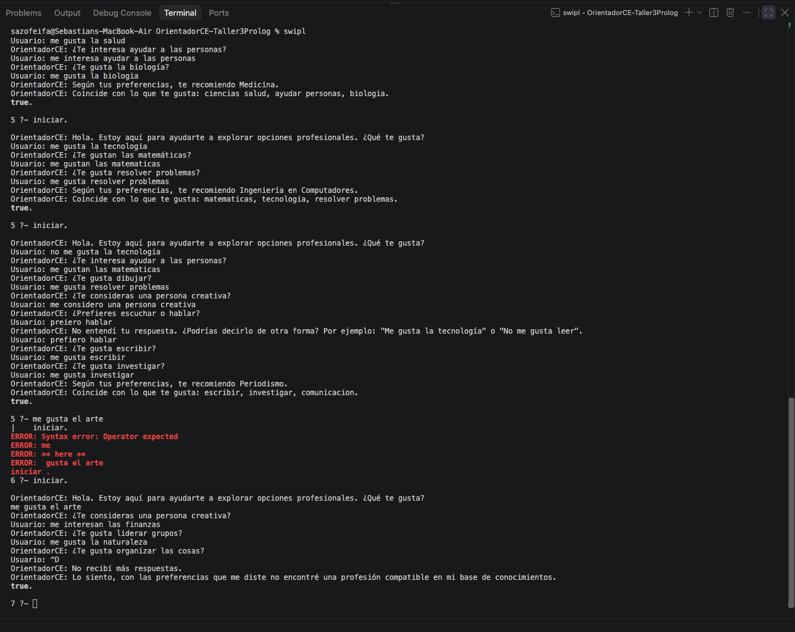
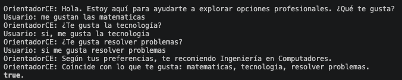
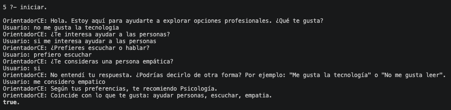
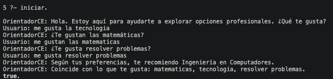
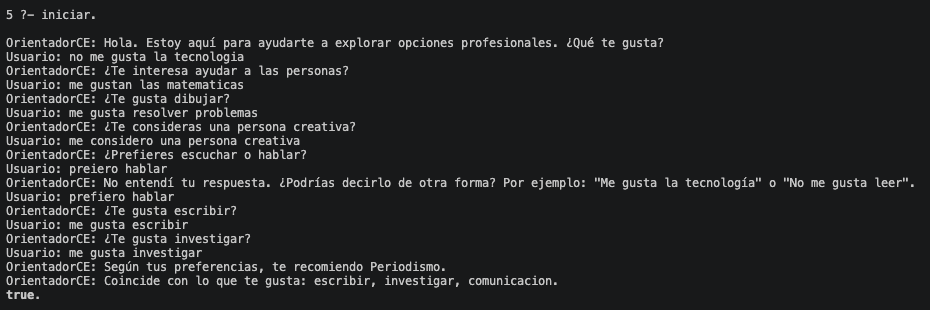
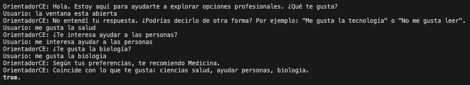
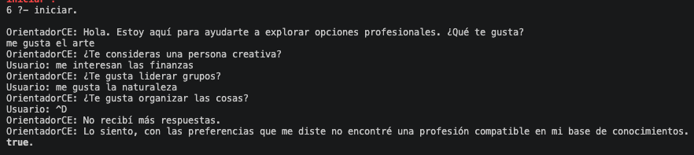

# OrientadorCE — Sistema experto de orientación vocacional en Prolog

**Taller #3 — Paradigmas de Programación (CE1106)**  
Instituto Tecnológico de Costa Rica · Ingeniería en Computadores · Segundo Semestre 2026

OrientadorCE es un sistema experto que conversa con el usuario en lenguaje natural (español),
interpreta sus intereses mediante una **gramática libre de contexto (DCG)**, guarda sus
preferencias afirmativas y negativas, y **recomienda una o varias profesiones** compatibles con
su perfil usando reglas del paradigma lógico. La interacción es por consola (sin interfaz gráfica).

---

## 1. Integrantes y aportes

| Persona | Nombre | Correo | Archivo / aporte principal |
|---|---|---|---|
| 1 | Ian Bonilla | i.bonilla.1@estudiantec.cr | `BD.pl` — base de conocimientos |
| 2 | Sebastián Azofeifa | sazofeifa@estudiantec.cr | `BNF.pl` — gramática e interpretación |
| 3 | Bryan Sibaja | brsibaja@estudiantec.cr | `Logic.pl` — reglas de recomendación e interacción |

**Aporte detallado**

- **Ian Bonilla (Persona 1) — `BD.pl`:** definió las 10 profesiones, y para cada una su lista de
  afinidades/fortalezas y su lista de aspectos incompatibles o preferencias contrarias.
- **Sebastián Azofeifa (Persona 2) — `BNF.pl`:** escribió la gramática libre de contexto en DCG
  (descrita en BNF), el tokenizador (minúsculas, sin acentos y sin puntuación), el léxico de
  intereses, el manejo de polaridad afirmativa/negativa y el predicado `interpretar/2` que consume
  `Logic.pl`. Además elaboró los casos de prueba y esta documentación.
- **Bryan Sibaja (Persona 3) — `Logic.pl`:** programó las reglas de recomendación (descarte por
  preferencias negativas, conteo de coincidencias, selección de las mejores opciones), el control
  de la conversación, la solicitud de reformulación y los mensajes al usuario.

---

## 2. Requisitos y ejecución

**Requisito:** [SWI-Prolog](https://www.swi-prolog.org/) (probado con la versión 10.0.2).

```bash
# macOS
brew install swi-prolog
```

**Inicio del programa** (desde la carpeta del proyecto):

```prolog
swipl
?- consult('Logic.pl').
?- iniciar.
```

O en un solo comando:

```bash
swipl -g "consult('Logic.pl'), iniciar" -t halt
```

Solo se debe cargar **`Logic.pl`**: este ya incluye `BD.pl` y `BNF.pl` mediante `ensure_loaded/1`.
El programa hace preguntas; el usuario responde con **frases en lenguaje natural** (no basta con
“sí” o “no”). Ejemplos de respuestas válidas: *“Me gustan las matemáticas”*, *“No me gusta la
tecnología”*, *“Disfruto trabajar con tecnología”*, *“Prefiero escuchar a los demás”*.

Para probar únicamente la gramática sin la conversación:

```prolog
?- consult('BNF.pl').
?- probar_gramatica.
```

---

## 3. Arquitectura

| Archivo | Responsabilidad |
|---|---|
| `BD.pl` | Hechos y **base de conocimientos**: profesiones, afinidades/fortalezas y aspectos incompatibles (listas). |
| `BNF.pl` | **Gramática libre de contexto (DCG)** y procesamiento de las respuestas: `interpretar(+Texto, -Preferencias)`. |
| `Logic.pl` | **Reglas de recomendación** y control de la **interacción** por consola; carga los otros dos archivos. |

Flujo: `Logic.pl` imprime una pregunta → lee una línea → la envía a `interpretar/2` → si la
reconoce, registra las preferencias; si no, pide reformular y **no registra nada**.

---

## 4. Base de conocimientos (`BD.pl`)

Se modelan **10 profesiones**. Cada profesión tiene una lista de **afinidades/fortalezas** y una
lista de **incompatibles** (preferencias contrarias).

```prolog
profesion(ingenieria_computadores).
afinidades(ingenieria_computadores, [matematicas, tecnologia, resolver_problemas]).
incompatibles(ingenieria_computadores, [rechazo_tecnologia, aversion_matematicas]).
```

| Profesión | Afinidades / fortalezas | Aspectos incompatibles |
|---|---|---|
| Ingeniería en Computadores | matemáticas, tecnología, resolver problemas | rechazo a la tecnología, aversión a las matemáticas |
| Psicología | ayudar a las personas, escuchar, empatía | trabajo aislado, falta de paciencia |
| Medicina | ciencias de la salud, ayudar a las personas, biología | impresión ante la sangre, falta de empatía |
| Derecho | lectura, debate, justicia | rechazo a la lectura, miedo a hablar en público |
| Arquitectura | dibujo, matemáticas, creatividad | rechazo al dibujo, desorden espacial |
| Administración | liderazgo, finanzas, organización | desorganización, rechazo a los números |
| Diseño Gráfico | creatividad, arte, tecnología | rechazo al arte, falta de imaginación |
| Biología | naturaleza, investigación, ciencias | rechazo a la naturaleza, trabajo encerrado |
| Periodismo | escribir, investigar, comunicación | timidez extrema, mala redacción |
| Educación Física | deportes, enseñanza, movimiento | sedentarismo, rechazo a los deportes |

**Lista completa de intereses (vocabulario que reconoce la gramática):**
`matematicas`, `tecnologia`, `resolver_problemas`, `ayudar_personas`, `escuchar`, `empatia`,
`ciencias_salud`, `biologia`, `lectura`, `debate`, `justicia`, `dibujo`, `creatividad`,
`liderazgo`, `finanzas`, `organizacion`, `arte`, `naturaleza`, `investigacion`, `investigar`,
`ciencias`, `escribir`, `comunicacion`, `deportes`, `ensenanza`, `movimiento`.

> Las asociaciones son simplificaciones con fines educativos; **no** constituyen un diagnóstico
> vocacional profesional.

---

## 5. Gramática y BNF (`BNF.pl`)

La gramática es **libre de contexto**, se describe en **BNF** y se implementa con **DCG** (`-->`)
de Prolog.

```bnf
<oracion>   ::= <clausula> | <clausula> <conector> <oracion>
<conector>  ::= "y" | "tambien"

<clausula>  ::= "no" <clausula_afirmativa>     % negación con "no"
              | <clausula_negativa>            % verbos negativos: odio, detesto, me disgusta...
              | <clausula_afirmativa>

<clausula_afirmativa> ::= <afirmador> <sujeto> <predicado_pos> <complementos>
                        | <complementos>                 % frase nominal suelta
<clausula_negativa>   ::= <sujeto> <predicado_neg> <complementos>

<afirmador> ::= "si" | "claro" | "por supuesto" | <vacio>
<sujeto>    ::= "yo" | "a mi" | <vacio>

<predicado_pos> ::= "me gusta" | "me gustan" | "me interesa" | "me interesan" |
                    "me encanta" | "me encantan" | "me agrada" | "me agradan" |
                    "me apasiona" | "me llama la atencion" | "disfruto" |
                    "disfruto de" | "prefiero" | "quiero" | "tengo interes en" |
                    "me considero" | "soy bueno en" | "soy buena en" | ...

<predicado_neg> ::= "me disgusta" | "me disgustan" | "odio" | "detesto" |
                    "aborrezco" | "no soporto" | "no tolero" | "evito"

<complementos> ::= <complemento> | <complemento> <conector> <complementos>
<complemento>  ::= <intensificador> <locucion> <articulo> <nucleo>
<intensificador> ::= "mucho" | "bastante" | "demasiado" | <vacio>
<locucion>       ::= "trabajar con" | "trabajar en" | "estudiar" |
                     "trabajar" | "usar" | "con" | <vacio>
<articulo>       ::= "el" | "la" | "los" | "las" | "un" | "una" | <vacio>
<nucleo>         ::= términos que identifican un interés (léxico en nucleo//2)
```

**Representación de salida:** `interpretar/2` devuelve una lista de preferencias
`gusta(Interes)` / `no_gusta(Interes)`. Si la frase no pertenece al lenguaje, **falla**.

Ejemplos admitidos:

| Frase del usuario | Representación |
|---|---|
| `Me gustan las matemáticas` | `[gusta(matematicas)]` |
| `Disfruto trabajar con tecnología` | `[gusta(tecnologia)]` |
| `Me gusta resolver problemas` | `[gusta(resolver_problemas)]` |
| `Me interesa ayudar a las personas` | `[gusta(ayudar_personas)]` |
| `Prefiero escuchar a los demás` | `[gusta(escuchar)]` |
| `No me gusta la tecnología` | `[no_gusta(tecnologia)]` |
| `Odio leer` | `[no_gusta(lectura)]` |
| `Me gusta leer y dibujar` | `[gusta(lectura), gusta(dibujo)]` |
| `La ventana está abierta` | **falla** (no se reconoce) |

Detalles de implementación:

- **Normalización:** pasa todo a minúsculas, elimina acentos (`tecnología` → `tecnologia`,
  `demás` → `demas`) y descarta signos de puntuación.
- **Polaridad:** la partícula `no` al inicio de la cláusula se maneja con la regla
  `<clausula> ::= "no" <clausula_afirmativa>`; los verbos negativos (`odio`, `detesto`, …) tienen
  su propia regla. En ambos casos la preferencia se convierte en `no_gusta(...)`.
- **Múltiples intereses:** el conector `y` permite reconocer varias preferencias en una sola frase.

---

## 6. Reglas de recomendación (`Logic.pl`)

Las preferencias detectadas se guardan como hechos dinámicos `gusta/1` y `no_gusta/1`.

1. **Descarte** (`descartada/1`): una profesión se descarta si
   - al usuario **no le gusta** alguna de sus afinidades, **o**
   - al usuario **le gusta** algo que figura en su lista de **incompatibles**.
2. **Coincidencias** (`coincidencias/2`): cuenta cuántas afinidades de la profesión le gustan al
   usuario.
3. **Compatibilidad** (`compatible/2`): la profesión no está descartada y tiene **al menos 2**
   coincidencias (`min_coincidencias(2)`).
4. **Mejores opciones** (`mejores_opciones/1`): de las compatibles se toman las de **mayor número
   de coincidencias**. Si hay empate, se muestran **varias** opciones.
5. Si **ninguna** profesión cumple, informa que **no encontró** una recomendación compatible y
   recuerda qué preferencias negativas se usaron para descartar profesiones.

**Selección de la siguiente pregunta:** se pregunta por una afinidad de la profesión no descartada
que lleva más coincidencias (para confirmarla o descartarla), evitando repetir preguntas
(`preguntado/1`). Se preguntan como máximo 8 intereses después de la pregunta inicial.

**Ejemplo de justificación (Caso 1):** con `gusta(matematicas)`, `gusta(tecnologia)` y
`gusta(resolver_problemas)`, Ingeniería en Computadores acumula 3 coincidencias (el máximo) y no
está descartada → se recomienda.

---

## 7. Casos de prueba

Comando usado para reproducir cada caso (las entradas se escriben línea por línea):

```bash
swipl -g "consult('Logic.pl'), iniciar" -t halt
```

### Resumen

| # | Caso | Resultado esperado | Resultado obtenido | Estado |
|---|---|---|---|---|
| 1 | Perfil tecnológico | Profesión compatible con matemáticas, tecnología y resolución de problemas | **Ingeniería en Computadores** | ✅ Pasa |
| 2 | Perfil social | Reconoce la negativa y recomienda algo afín al interés social y la escucha | **Psicología** | ✅ Pasa |
| 3 | Negación de una afinidad | Interpreta distinto ambas frases; la negativa se considera | Positivo → Ingeniería; negativo → descarta Ingeniería (recomienda **Periodismo**) | ✅ Pasa |
| 4 | Respuesta no reconocida | Pide reformular sin registrar y continúa con la válida | Pidió reformular “La ventana está abierta” y siguió con la frase válida | ✅ Pasa |
| 5 | Perfil sin coincidencias | Informa que no hay recomendación sin contradecir preferencias | Informó **ausencia de coincidencias** | ✅ Pasa |

### Evidencia general

Captura de la **terminal integrada de VS Code** con el proyecto abierto y varias corridas reales del
programa en la computadora del equipo (se ven, entre otras, las recomendaciones de Medicina,
Ingeniería en Computadores y el mensaje de perfil sin coincidencias):



---

### Caso 1 — Perfil tecnológico

**Entradas:** `me gustan las matematicas` · `si, me gusta la tecnologia` · `si me gusta resolver problemas`  
**Resultado esperado:** recomienda una profesión compatible con matemáticas, tecnología y resolución de problemas.  
**Resultado obtenido:** **Ingeniería en Computadores** (3 coincidencias). **Estado: ✅ Pasa.**



---

### Caso 2 — Perfil social

**Entradas:** `no me gusta la tecnologia` · `si me interesa ayudar a las personas` · `prefiero escuchar` · `si` · `me considero empatico`  
**Resultado esperado:** reconoce la preferencia negativa y recomienda una profesión compatible con el
interés social y la escucha.  
**Resultado obtenido:** **Psicología** (afinidades *ayudar a las personas* y *escuchar*; la negativa
sobre tecnología se registró y descontó Diseño Gráfico). La respuesta suelta `si` **no** se aceptó
(el sistema pidió reformular) y el usuario reformuló con `me considero empatico`. **Estado: ✅ Pasa.**



---

### Caso 3 — Negación de una afinidad

Se ejecuta dos veces cambiando únicamente “me gusta la tecnología” por “no me gusta la tecnología”.
En ambas corridas el sistema responde de forma distinta y la preferencia negativa se usa para
descartar profesiones.

**3a — Tecnología positiva**

**Entradas:** `me gusta la tecnologia` · `me gustan las matematicas` · `me gusta resolver problemas`  
**Esperado/Obtenido:** **Ingeniería en Computadores**.



**3b — Tecnología negativa**

**Entradas:** `no me gusta la tecnologia` · `me gustan las matematicas` · `me gusta resolver problemas` · `me considero una persona creativa` · `prefiero hablar` · `me gusta escribir` · `me gusta investigar`  
**Esperado:** la negativa **no** se registra como afinidad y se considera al recomendar.
**Obtenido:** `no_gusta(tecnologia)` se registró y **Ingeniería en Computadores quedó descartada**
aunque al usuario le gustan matemáticas y resolver problemas; con las preferencias adicionales
dadas, el sistema terminó recomendando **Periodismo** (afinidades *escribir*, *investigar* y
*comunicación*). El programa también pidió reformular una respuesta no reconocida (`preiero hablar`).



**Estado: ✅ Pasa.** El sistema interpreta de forma diferente ambas frases y la preferencia negativa
se registra en `no_gusta/1` y descarta Ingeniería en Computadores (en 3a la tecnología era la
afinidad determinante para recomendarla; en 3b deja de recomendarse).

---

### Caso 4 — Respuesta no reconocida

**Entradas:** `la ventana esta abierta` · `me gusta la salud` · `me interesa ayudar a las personas` · `me gusta la biologia`  
**Resultado esperado:** solicita reformular la primera respuesta sin registrar una preferencia
incorrecta, y continúa al recibir una frase válida.  
**Resultado obtenido:** mostró *“No entendí tu respuesta… ¿Podrías decirlo de otra forma?”*,
**no** registró la frase inválida y continuó normalmente hasta **Medicina**
(afinidades *ciencias de la salud*, *ayudar a las personas* y *biología*). **Estado: ✅ Pasa.**



---

### Caso 5 — Perfil sin coincidencias

**Entradas:** `me gusta el arte` · `me interesan las finanzas` · `me gusta la naturaleza` (y **Ctrl-D** en el prompt `Usuario:` para terminar la entrada)  
**Resultado esperado:** informa que no dispone de una recomendación compatible, sin fallar ni
recomendar algo que contradiga las preferencias.  
**Resultado obtenido:** *“Lo siento, con las preferencias que me diste no encontré una profesión
compatible en mi base de conocimientos.”* **Estado: ✅ Pasa.**

**Justificación de la ausencia de coincidencias:** las tres preferencias pertenecen a profesiones
distintas y ninguna profesión reúne al menos 2 de ellas:

| Preferencia | Profesión con esa afinidad | Coincidencias de esa profesión |
|---|---|---|
| arte | Diseño Gráfico | 1 (solo arte) |
| finanzas | Administración | 1 (solo finanzas) |
| naturaleza | Biología | 1 (solo naturaleza) |

Como `min_coincidencias(2)` exige **2 o más** coincidencias y ninguna profesión las alcanza, el
sistema no recomienda nada y **no** contradice ninguna preferencia.



> Nota: las capturas son de la terminal integrada de VS Code en la computadora del equipo. En los
> casos en que el guion de prueba se queda sin líneas se muestra `Usuario: (Ctrl-D)` (fin de
> entrada); en uso interactivo el usuario puede seguir respondiendo. Las transcripciones en texto
> plano de cada caso están en [`evidencias/transcripciones/`](evidencias/transcripciones/).

---

## 8. Limitaciones conocidas

- **Vocabulario limitado:** solo reconoce las palabras/estructuras documentadas en `BNF.pl`. Por
  ejemplo, *“Me gusta la música”* no se reconoce porque *música* no es un interés de la base de
  conocimientos.
- **Español acotado:** no se maneja cualquier oración del español (pronombres, tiempos verbales
  complejos, subordinadas, doble negación).
- **Respuestas “sí/no” aisladas** no se interpretan como preferencia (el enunciado lo prohíbe);
  se debe responder con una frase.
- **Umbral de coincidencias:** el resultado depende de `min_coincidencias(2)`; cambiarlo altera qué
  perfiles obtienen recomendación.
- **Sin contexto entre preguntas:** una frase válida se registra aunque no responda exactamente a
  la pregunta hecha.
- **Acentos:** se normalizan mediante una tabla; caracteres fuera de la tabla no se convierten.
- **Sin interfaz gráfica** y sin persistencia entre ejecuciones.

---

## 9. Fuentes consultadas

- SWI-Prolog. *DCG (Definite Clause Grammars)* y documentación general. https://www.swi-prolog.org/
- Clase de **Paradigmas de Programación (CE1106)**, Segundo Semestre 2026 — material de Prolog y gramáticas.
- Enunciado del **Taller #3: OrientadorCE**.
